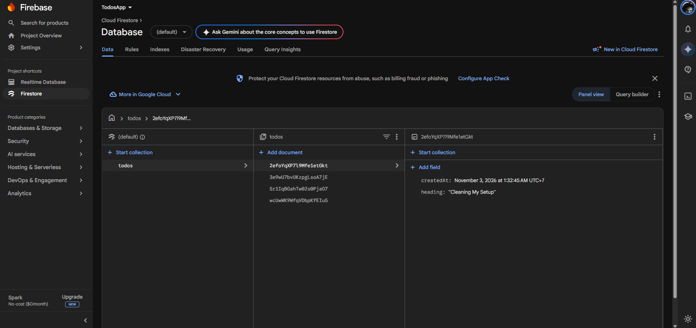

<div align="center">

# Todo List App

**Aplikasi mobile sederhana untuk mengelola daftar kegiatan dengan React Native, Expo, dan Firebase.**

Dibuat sebagai tugas mata kuliah **Pemrograman Mobile**.


</div>

## Tentang aplikasi

Todo List App membantu pengguna mencatat kegiatan sehari-hari. Data disimpan di **Cloud Firestore**, sehingga daftar diperbarui secara real-time. Aplikasi memiliki halaman daftar todo dan halaman untuk mengedit todo.

### Tampilan aplikasi

<table>
  <tr>
    <td align="center">
      
      <br><sub>Daftar todo</sub>
    </td>
    <td align="center">
      
      <br><sub>Daftar kegiatan</sub>
    </td>
    <td align="center">
      
      <br><sub>Edit todo</sub>
    </td>
  </tr>
</table>

### Data di Cloud Firestore

Setiap todo disimpan sebagai dokumen di koleksi `todos`.

<p align="center">
  
</p>

<details>
  <summary>Lihat contoh struktur dokumen</summary>

| Field | Tipe | Keterangan |
| --- | --- | --- |
| `heading` | String | Judul todo |
| `createdAt` | Timestamp | Waktu pembuatan todo |

</details>

## Fitur

| Fitur | Keterangan |
| --- | --- |
| **Read** | Menampilkan daftar todo dan menerima pembaruan data secara real-time. |
| **Create** | Menambahkan todo baru ke Firestore. |
| **Update** | Mengubah judul todo melalui halaman detail. |
| **Delete** | Menghapus todo dari daftar dan Firestore. |

## Teknologi

- **React Native 0.88** untuk membangun antarmuka aplikasi mobile.
- **Expo SDK 58** untuk menjalankan aplikasi dan mengelola proses pengembangan.
- **React Navigation** untuk navigasi native antara halaman Home dan Detail.
- **Firebase JavaScript SDK 8** dan **Cloud Firestore** untuk penyimpanan serta sinkronisasi data.

## Persyaratan

- Node.js 22.13 atau lebih baru (Node.js 24 direkomendasikan).
- npm.
- Expo Go yang mendukung SDK 58.
- Proyek Firebase dengan Cloud Firestore aktif.

## Menyiapkan proyek

### 1. Pasang dependensi

Clone atau unduh repository, buka terminal di folder proyek, lalu jalankan:

```bash
npm install
```

### 2. Siapkan Firebase

1. Buat atau buka proyek di [Firebase Console](https://console.firebase.google.com/).
2. Buat database **Cloud Firestore**.
3. Ambil konfigurasi aplikasi Firebase dari pengaturan proyek.
4. Sesuaikan objek `firebaseConfig` di [`config.js`](./config.js) dengan konfigurasi proyek Anda.
5. Siapkan **Firestore Security Rules** yang sesuai untuk aplikasi. Aplikasi ini belum menggunakan autentikasi, jadi jangan gunakan aturan publik yang memberi semua orang akses baca dan tulis.

Koleksi `todos` akan dibuat otomatis saat todo pertama ditambahkan. Dokumennya memiliki field `heading` dan `createdAt`.

### 3. Jalankan aplikasi

Jalankan server Expo menggunakan tunnel:

```bash
npx expo start --tunnel ngrok --clear
```

Setelah terminal menampilkan **Tunnel ready** dan QR code, pindai QR dengan Expo Go. Pastikan ponsel dan komputer memiliki akses internet. Jika server lama masih berjalan, hentikan terlebih dahulu dengan `Ctrl+C`.

## Struktur folder

```text
.
├── App.js                  # Navigasi halaman aplikasi
├── config.js               # Inisialisasi Firebase dan Firestore
├── Screens/
│   ├── Home.js             # Daftar todo dan aksi tambah/hapus
│   └── Detail.js           # Form untuk mengubah todo
├── assets/
│   └── Screenshots/        # Screenshot aplikasi dan Cloud Firestore
├── app.json                # Konfigurasi Expo
└── package.json            # Dependensi proyek
```

## Alur aplikasi

1. `App.js` menyiapkan navigasi native stack.
2. `Home.js` membaca koleksi `todos` dan menampilkan datanya secara real-time.
3. Pengguna menambahkan todo dari halaman Home atau menghapusnya dari daftar.
4. Memilih todo membuka halaman Detail untuk mengubah judul.
5. Perubahan dikirim ke Cloud Firestore dan daftar diperbarui.

## Pemecahan masalah

- **Versi SDK tidak cocok:** pastikan Expo Go mendukung SDK 58 dan QR berasal dari server yang baru dijalankan.
- **Tunnel tidak tersambung:** periksa koneksi internet dan jalankan ulang `npx expo start --tunnel ngrok --clear`.
- **Firestore tidak dapat diakses:** pastikan Cloud Firestore sudah dibuat, ponsel terhubung ke internet, dan Security Rules mengizinkan operasi yang diperlukan.

## Referensi

- [Dokumentasi React Native](https://reactnative.dev/docs/getting-started)
- [Dokumentasi Expo](https://docs.expo.dev/)
- [Dokumentasi Firebase Web](https://firebase.google.com/docs/web/setup)
- [Tutorial Todo List yang menjadi referensi awal](https://www.bagi2info.com/todosapp-sample-crud-react-native-expo-and-firebase/)
- [Repository sumber](https://github.com/imrohit007/CRUD-React-Native-Expo-And-Firebase)
